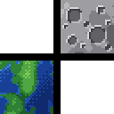
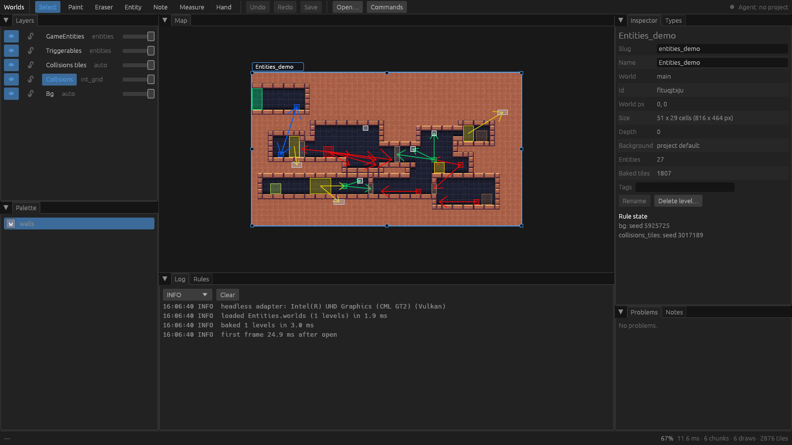
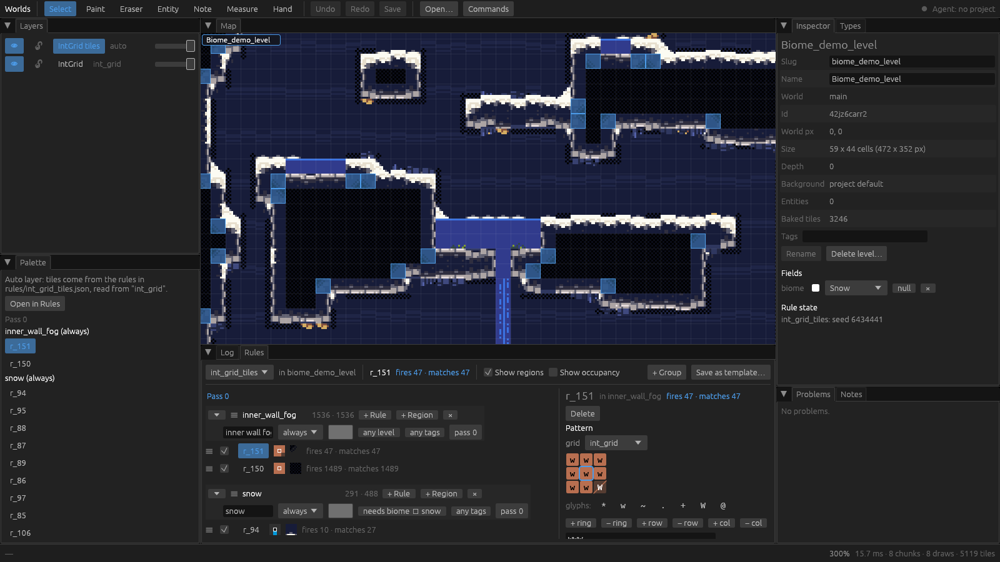

# Worlds

Worlds is a 2D tile-based level editor written in Rust, built with Godot 4
games in mind. You get grid layers, rule-based autotiling, typed entities and
many levels laid out on one world map — and an editor that agents can drive.
The open project has a live JSON-RPC API and an MCP server, so Claude Code
(or any MCP client) can paint, place and fix things while you watch the
canvas, with every agent edit landing as one undo step.



What sets it apart:

- **Agent-friendly files.** A project is a directory of small,
  schema-checked JSON files (one per level layer, rule set, entity type...),
  so an agent or a human can read, edit and diff them directly. `validate`
  reports every problem with its file and JSON path.
- **A live API.** Edit the open project over a localhost WebSocket
  ([docs/api.md](docs/api.md)) or through MCP tools ([docs/mcp.md](docs/mcp.md)).
  Without the editor open, the same tools write to disk.
- **Rules that scale.** Autotile rules can each draw from their own tileset,
  and come with macros, templates, stamps, region rules (match whole rooms,
  floors or wall runs), multi-pass derived layers and even spacing, with an
  incremental bake that keeps up as you paint.
- **Organised entities.** A searchable category tree with favorites, and an
  inspector for typed fields.
- **Notes on the map.** Notes, pins, paths, regions and locked guides, at
  world or level scope.
- **Crash-safe.** Unsaved edits autosave every 30 s; after a crash the editor
  offers a diff to recover or discard.



The design and its reasoning are in [docs/DESIGN.md](docs/DESIGN.md).

Licence: GPL-3.0 ([LICENSE](LICENSE)).

## Build

Rust 1.95 or newer (edition 2024), and a GPU wgpu can use for the editor.

```sh
cargo build --release
```

Binaries in `target/release/`:

| Binary | What it is |
| --- | --- |
| `worlds` | the editor (window; also headless screenshots and scripts) |
| `worlds-cli` | `new`, `validate`, `bake`, `check-export`, `schema`, `import-ldtk` |
| `worlds-mcp` | MCP server (stdio) for agents |
| `worlds-server` | the live API on a project without the editor (tests, tools) |

## Quick start

```sh
worlds-cli new mygame.worlds                  # an empty project
worlds mygame.worlds                          # open it; paint, place, Ctrl+S saves
worlds-cli validate mygame.worlds             # every problem, with file and JSON path
worlds-cli bake mygame.worlds                 # writes mygame.worlds/export/ for the game
worlds-cli check-export mygame.worlds/export --project mygame.worlds --fresh
                                              # export well formed and up to date (exit 0)
```

Coming from LDtk? `worlds-cli import-ldtk` converts an LDtk 1.5 project; see
[docs/importing_ldtk.md](docs/importing_ldtk.md).

## Using the export in your game

`bake` writes `export/`: a `world.json` index, `enums.json`, and one
`levels/<slug>.json` per level with its grids, baked tiles, entities and
exported notes. Your game (or a Godot editor plugin) reads those files; you
never edit them by hand. The format, and what `check-export` verifies, are in
[docs/format.md](docs/format.md#export-generated).

## Agents (Claude Code)

Put a `.mcp.json` at your game repo's root:

```json
{ "mcpServers": { "worlds": {
  "command": "/path/to/worlds/target/release/worlds-mcp",
  "args": ["--project", "mygame.worlds"] } } }
```

With the editor open, edits go through it and appear live (one undo entry
per tool call, optionally waiting for your approval); with it closed,
`worlds-mcp` writes the files itself. See [docs/mcp.md](docs/mcp.md).

## Docs

| | |
| --- | --- |
| [docs/DESIGN.md](docs/DESIGN.md) | goals, architecture, decisions |
| [docs/format.md](docs/format.md) | the project files and the export, for hand (or agent) editing |
| [docs/commands.md](docs/commands.md) | the edit commands (the undo unit) |
| [docs/api.md](docs/api.md) | the live JSON-RPC API |
| [docs/mcp.md](docs/mcp.md) | the MCP tools |
| [docs/importing_ldtk.md](docs/importing_ldtk.md) | `worlds-cli import-ldtk` |
| [docs/ldtk_parity.md](docs/ldtk_parity.md) | LDtk's auto-layer rule semantics, as reference for the engine |
| `crates/*/README.md` | per crate: editor, server, MCP, rules engine |

## Testing

```sh
cargo test --workspace                              # everything that needs no GPU
WORLDS_GPU_TESTS=1 cargo test -p worlds-editor      # editor GPU and window tests (Xvfb for the window ones)
cargo clippy --workspace --all-targets -- -D warnings && cargo fmt --check
```

The GPU tests run on `tests/fixtures/game/`, a small platformer project
with procedurally drawn tiles (`make.py` regenerates it). The window tests
need `xvfb-run` and `libxkbcommon-x11.so`; where the system has none, set
`WORLDS_XKB_DIR` to a directory holding it.

The screenshots above are of LDtk's sample projects (in
`tests/fixtures/ldtk-samples/`, credits in its
[ATTRIBUTION.md](tests/fixtures/ldtk-samples/ATTRIBUTION.md)), imported
with `import-ldtk`.
