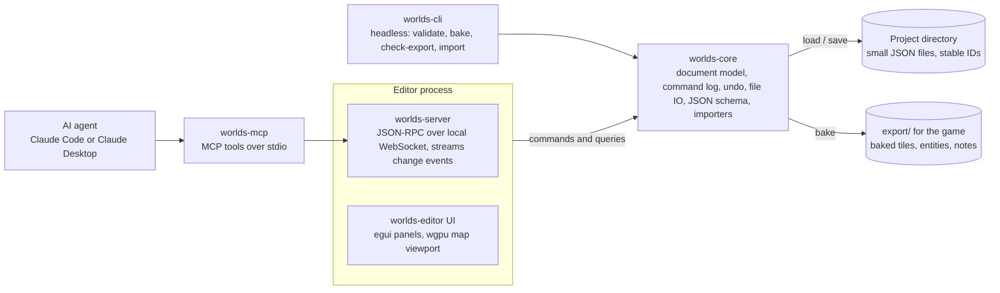

# Worlds — Design Doc

Worlds is a 2D level editor written in Rust, built for Godot 4 games. The application is called Worlds, the binary is `worlds`, every crate is `worlds-*`, project directories end in `.worlds`.

## Goals and non-goals

Worlds keeps the proven core of a grid level editor (grid layers, rule-based autotiling, typed entities, one project with many levels) and is designed around six goals.

| # | Goal | What Worlds does |
| --- | --- | --- |
| 1 | An API, not just a GUI. | A local JSON-RPC server runs inside the editor. An MCP server wraps it so an agent can read and edit the open project and the canvas updates live. |
| 2 | Autotile rules aren't tied to one tileset per layer. | Each rule names its own tileset. A layer can mix tilesets with different tile sizes and atlas dimensions. |
| 3 | An entity palette that scales past a few dozen types. | Entities live in a category tree with search, favorites, the recently used types and a per-level "in this level" list with counts. The palette shows icons, not just names. |
| 4 | Notes and markers on the world map. | First-class annotations outside the layer stack: notes, pins, paths, regions and guides with text, tags and links, at world and level scope. |
| 5 | Rules that can say "a 2x3 pillar every N tiles in rooms wider than W". | A rule language with named pattern macros, multi-tile stamps, region queries (room size, span) and spacing constraints. |
| 6 | A file format a model can diff and reason about. | One directory per project. Small, schema-validated JSON files with stable string IDs, no derived data, and a documented schema an agent can read. |

Non-goals for v1:

- Not a general tile-art tool. No pixel editing, no tileset authoring.
- Not an engine. Worlds exports data; the game renders it. No in-editor play mode in v1.
- Not a converter. Projects from other editors can be imported once (LDtk: `worlds-cli import-ldtk`, [importing_ldtk.md](importing_ldtk.md)); nothing is written back.
- Not multi-user. One editor process owns the project; the API is for one agent plus one human at a time.

## Architecture overview

One Cargo workspace, six crates. The important decision is that the editor GUI, the API server and the CLI are all thin clients of the same core crate, and every mutation is a serializable command. That one choice gives undo/redo, the live API, headless baking and deterministic tests without building any of them twice.



The agent never touches files while the editor is open. It talks to worlds-mcp, which forwards to the editor's socket, so what the agent changes is what you see on the canvas a frame later. If the editor isn't running, worlds-mcp loads the project headlessly through worlds-core and the same tools still work.

| Crate | Role | Depends on |
| --- | --- | --- |
| worlds-core | Project document model, stable IDs, command enum + apply/invert, undo stack, change events, load/save, JSON Schema generation, importers | serde, schemars |
| worlds-rules | Autotile engine: pattern matching, region analysis, stamps, deterministic RNG, incremental re-bake | worlds-core |
| worlds-server | JSON-RPC 2.0 over a localhost WebSocket. Exposes commands, queries, subscriptions and a PNG snapshot | worlds-core, tokio |
| worlds-editor | The desktop app, launched as `worlds`. egui for panels, a custom wgpu pass for the map viewport. Hosts worlds-server in-process | worlds-core, worlds-rules, worlds-server, eframe |
| worlds-mcp | MCP server (stdio). Coarse agent-friendly tools that map onto worlds-server calls, or onto worlds-core directly when no editor is running | worlds-core, worlds-rules |
| worlds-cli | validate, bake, check-export, schema, new, import. Used by CI and by a game's import step | worlds-core, worlds-rules |

Threading model inside the editor: the UI thread owns the document. Server requests arrive on a tokio runtime, get queued as commands, and the UI thread drains the queue once per frame. That keeps one writer, no locks on the hot path, and means an agent edit mid-drag just waits until the gesture ends. Autotile baking and thumbnail rendering run on a worker pool and post results back.

## Project file format

A project is a directory of small JSON files, one concern per file, with no derived data and no integer uids. The test for every design choice here: can an agent read one file, understand it without the rest, and write a correct edit with a plain text diff? A single large file of dense integer arrays, cached output and numeric cross-references fails that test.

```
my_game.worlds/
  project.json            name, grid size, world layout, seed, settings
  layers.json             layer definitions in draw order
  tilesets.json           image path, tile size, spacing
  enums.json              shared enums (Facing, Theme, Music ...)
  entities/
    floor_button.json     one entity definition per file
    gate.json
  rules/
    main_tiling.json      rule groups for one autotile layer
    macros.json           shared patterns, legends, tileset templates
  worlds/
    main/
      world.json          world-scope notes and guides, guide groups (level placements live in each level.json)
      levels/
        crevasse/
          level.json      size, position, level fields, bg
          collision.json  IntGrid layer (text rows + legend)
          decor_back.json Tiles layer (sparse placements)
          entities.json   entity instances
          notes.json      level-scope annotations
  schema/                 JSON Schema per file kind, generated by worlds-cli, committed
  export/                 baked output for the game, generated, committed
  .worlds/                cache: thumbnails, bake cache, server socket info (gitignored)
```

Identity rules:

- Definitions (layers, entities, tilesets, enums, rules, enum values, IntGrid values) are keyed by a snake_case slug that is also the file name. `"type": "floor_button"` reads as what it is. Renaming a slug is a refactor command that rewrites every reference, never a silent break.
- Instances (entities, notes, levels) get a short random id on creation (`e_7f3k2q`), stable for life. Levels also have a slug used for the directory and for the game's room name, so `crevasse` stays `crevasse`.
- Cross-references are always `{kind}:{slug}` or the instance id, never array indexes or uids. No mirrored copies of names.
- Every file carries `"$schema": "../../schema/level.json"` and a `"format": 1` version so an agent can validate before writing.

Grid layers are text, not CSV. The layer definition gives each IntGrid value a glyph, and the instance file repeats the legend so it stands alone:

```json
{
  "$schema": "../../../../schema/intgrid.json",
  "layer": "collision",
  "legend": { ".": null, "#": "solid", "-": "oneway", "b": "breakable",
              "f": "fortified", "~": "water", "x": "hazard", "/": "ramp_r", "L": "ramp_l" },
  "rows": [
    "####################",
    "#..................#",
    "#.......----.......#",
    "#####........../####",
    "####################"
  ]
}
```

A model can reason about geometry directly in that picture, and a git diff of a room edit is readable by a human.

A layer may set its own `grid_size`, which must divide or be a multiple of the project grid, so 16 px decor can sit over 32 px collision; an auto layer uses its source layer's grid. Tile layers are sparse lists sorted by row then column, so diffs are stable. Tiles are addressed by atlas column and row, not a linear index, so a tileset image growing by a row doesn't renumber everything:

```json
{ "layer": "decor_back",
  "tiles": [
    { "cell": [4, 2], "tileset": "ssw_set2_build1", "tile": [5, 1] },
    { "cell": [5, 2], "tileset": "ssw_set2_build1", "tile": [6, 1], "flip": "x" }
  ] }
```

Entity instances store a cell position plus an optional pixel offset, so grid-aligned placement reads as tiles while free placement is still possible:

```json
{ "id": "e_7f3k2q", "type": "floor_button", "cell": [12, 7],
  "fields": { "channel": 3, "latching": true } }
```

What is deliberately not stored: baked autotiles, denormalized world positions, pixel sizes that follow from cell counts, cached pixel data. All of that is computed on load or at bake time and goes to `export/` or `.worlds/`.

Saving is atomic per file (write temp, rename) and only touches files whose content changed, so a one-cell paint produces a one-file diff. The editor watches the project directory and reloads files changed by git or by an agent working on disk while the editor is closed; if the editor has unsaved edits to the same file it asks rather than clobbering.

The `export/` directory is the contract with the game. One `world.json` index plus one `levels/{slug}.json` per level: collision as rows and legend, each tile layer's placements grouped by tileset with baked autotiles included, entities with resolved world coordinates and typed field values, notes flagged for export. It is regenerated by `worlds-cli bake`, by the editor on save when the setting is on, or on request over the API.

## Autotiling engine

The engine is built on ordered groups of pattern rules, first match wins, deterministic randomness. On top of that: a rule names its own tileset, patterns are text, rules can run in passes that write intermediate grids, and a second rule kind works on regions instead of cells. A pillar every few cells in big rooms is two short rules.

Terms:

- **Source grid**: anything with a value per cell in a level. IntGrid layers by value name, plus *derived grids* that earlier passes write. Rules read any number of them.
- **Pattern**: rows of glyphs with a legend, like the grid files. `*` is don't-care, `!x` is not-x, `[a|b]` is either, `.` is empty, `@` marks the anchor cell when it isn't the center.
- **Output**: either tiles (one or more weighted alternatives, each a single tile or a multi-tile stamp from a named tileset) or a write into a derived grid.
- **Pass**: an ordered list of rule groups. Groups run in order, rules within a group in order; `break: true` locks that cell against every later rule, in this group and in later groups, which makes groups priority tiers. Later passes see what earlier passes wrote and are not blocked by locks from earlier passes.

A plain edge rule:

```json
{ "slug": "wall_top_edge",
  "match": { "grid": "collision", "legend": { "#": "solid", ".": "!solid" },
             "rows": [ "***", ".#.", "###" ] },
  "symmetry": [ "mirror_x" ],
  "out": { "tileset": "castle_main", "tiles": [ [15, 0], [16, 0], [17, 0], [18, 0] ] },
  "break": true }
```

Multi-tileset: `out.tileset` is per rule, so one layer can draw walls from `castle_main` and trims from `ssw_set3`. Tilesets can have different tile sizes. A 64 px stamp on a 32 px layer covers 2x2 cells and is placed by pixel, anchored by its pivot; stamp layout scales by the tileset's tile size, not the layer grid. The bake output is grouped by tileset, and the Godot side maps each tileset to an atlas source in one TileSet.

Stamps are rectangles cut from a tileset, with a pivot and an occupancy footprint:

```json
{ "slug": "pillar", "tileset": "ssw_set5", "rect": [12, 4, 2, 3], "pivot": [0.5, 1.0],
  "occupies": true }
```

When `occupies` is on, cells the stamp covers are marked in the layer's occupancy grid and later stamps with `avoid_overlap: true` skip them.

Region rules are the other half. A region is a 4-connected component of cells matching an expression, with a bounding box, width, height, area and edge cells (floor cells are empty cells with solid below, and so on). A region rule selects regions by those properties and places output along an edge or across the interior with a spacing strategy:

```json
{ "slug": "big_room_pillars",
  "region": { "grid": "collision", "cells": ".", "min_width": 14, "min_height": 6 },
  "place": { "along": "floor", "every": 6, "align": "center", "margin": 3 },
  "write": { "grid": "decor_marks", "value": "pillar_base" } }
```

That writes `pillar_base` into a derived grid at evenly spaced floor cells of every room at least 14 wide and 6 tall, centered so the spacing is symmetric, keeping 3 cells clear of the walls. A second group in the next pass stamps the art and checks the space is free:

```json
{ "slug": "pillar_stamp",
  "match": { "grid": "decor_marks", "legend": { "p": "pillar_base" }, "rows": [ "p" ] },
  "require": { "grid": "collision", "legend": { ".": "!solid" }, "rows": [ "..", "..", "@." ] },
  "out": { "stamp": "pillar", "avoid_overlap": true },
  "chance": 1.0 }
```

Splitting "where" from "what" is the point. The same `decor_marks` grid can drive torches, banners or cracks with different stamps, and you can paint `decor_marks` by hand to override the rule where a room needs it. Derived grids are declared as `int_grid` layers flagged `derived: true`. Only hand-painted overrides are saved; the rest is recomputed from rules and shown in the editor as a semi-transparent overlay.

Other rule features: `chance`, `modulo` with offsets, checker, Perlin noise gate, out-of-bounds value, per-rule alpha and pixel offset, random tile offsets, group modes (always, optional, off) and per-level optional groups, `rotate` symmetry (90-degree variants, exported as Godot transpose+flip, off by default per rule), and `require` as a second pattern that must also hold. Their exact semantics are in [format.md](format.md); [ldtk_parity.md](ldtk_parity.md) is reference material on the pattern semantics the importer carries over.

Macros live in `rules/macros.json`: named patterns (`edge_top`, `inner_corner_ne`), named legends, and *templates*. A template is a parameterized group, so the standard 47-piece blob for a new tileset is one line: `{ "use": "blob47", "tileset": "ssw_set4", "origin": [0, 8] }`. The editor's rule wizard writes a template reference instead of expanding to 47 rules.

Determinism: every random choice is `hash(project.seed, level.id, layer, rule.slug, x, y)`. Baking the same project twice gives byte-identical export files, and a one-cell edit changes only tiles near it.

Incremental baking: a paint stroke marks dirty cells. Cell rules re-run on the dirty set grown by the largest pattern radius in the layer. Region rules re-run for any region whose component touches a dirty cell. Target is under 2 ms per stroke on a 64x28 room with 50 rules. Full rebake of all levels runs on the worker pool at open and after rule edits.

The editor side: rules are edited in a panel that shows the pattern as a mini grid you click but also as the text you'd write by hand, with live "where does this rule fire" highlighting on the canvas and a count. Dragging a rule between groups or passes is drag and drop. An agent edits the same JSON over the API and sees the same highlighting via a snapshot.

## Entities

Entity definitions are a typed box with fields, a pivot, a tile icon and limits, plus a category path for the palette.

One definition file per entity type:

```json
{ "$schema": "../schema/entity.json",
  "slug": "locked_door", "name": "Locked Door",
  "category": "Puzzle/Doors", "tags": ["object", "puzzle"],
  "doc": "Opens when the player holds needs_item. Footprint is w x h tiles.",
  "size": [1, 3], "resizable": [false, true], "pivot": [0.5, 1.0],
  "icon": { "tileset": "ssw_set2_build1", "tile": [3, 7] }, "color": "#c08040",
  "limit": null,
  "fields": [
    { "slug": "channel", "type": "int", "default": 0, "min": 0 },
    { "slug": "needs_item", "type": "string", "default": "" },
    { "slug": "consumes", "type": "bool", "default": false }
  ] }
```

Field types: int, float, bool, string, text (multiline), color, enum (project enum or inline values), point (cell in this level), entity_ref (with allowed types or tags, optional cross-level), path (file), tile, and any of those as an array. Plus `json` for a free-form object. Per-field: default, min/max, regex, nullable, and display options (show on canvas, show as arrow to referenced entity, show in world view).

The palette is a dock panel with four stacked parts, each collapsible:

1. **Search box** that is always focused when the entity tool is active. Fuzzy on name, slug, tags and category. Typing filters all parts below; Enter picks the first hit; Escape clears.
2. **Favorites and recent.** Starred types, then the last eight used in this project.
3. **In this level.** Every type present in the current level with a count. Clicking selects all instances of it.
4. **Catalogue tree** by `category` path, collapsible, remembered per project. Tag chips above it filter. Icon grid or list toggle. Hover shows the `doc` text.

Placing: click or drag to place, with the definition's size and pivot. Shift-drag resizes if resizable. Alt-click samples an existing entity's type and fields into the brush. Duplicate with Ctrl-D keeps fields. Entity instances snap to the cell grid by default, with a modifier for pixel placement.

The inspector shows the selected entity's fields as a form, with the definition's `doc` at the top. Multi-select shows common fields and edits them all. Entity references are picked by clicking the target on the canvas, including in another level in world view, or by typing its id. A referenced entity draws an arrow.

Validation runs live and shows in a problems panel: a reference to a deleted entity, a `limit` exceeded, a field outside min/max, an entity outside its level. Problems are also available over the API.

Definitions are edited in a definition panel with the same form, plus reorder, duplicate and a rename that rewrites references. Because definitions are plain files, an agent can add a new entity type by writing one file, and the editor picks it up on the next frame.

## Notes, markers and world geometry

Annotations are first-class objects, not entities in disguise, and live outside the layer stack. They exist at world scope (coordinates in world pixels, drawn across level boundaries) and at level scope, and they're never exported unless flagged. They serve two jobs: leaving design intent where it applies, and laying reference geometry over the world so levels can be built to a larger shape.

| Kind | Geometry | Typical use |
| --- | --- | --- |
| Note | point + text | "this shaft is the stem of the second glyph", todo items, design intent for an agent |
| Pin | point + icon + label | landmarks, exported so the game can place map markers |
| Path | polyline | a route through a chain of landmarks, a planned rope route, a measurement |
| Region | polygon or rect | an area's extent, a zone levels should sit inside |
| Guide | polyline or polygon, locked, world scope | reference lines to build along |

Every annotation has: id, kind, title, body (markdown), tags, color, `links` (entity ids, level slugs, URLs, other note ids), `status` (open or done), `export` (bool), `locked` (bool). World-scope ones live in `worlds/main/world.json`, level-scope ones in the level's `notes.json`.

How they combine:

- **Guides.** Locked polylines on the world view that a layout is built along, drawn by hand or written by a tool. Levels snap to guide lines when dragged if snapping is on. A guide group has its own offset, so a set of guides can be shown both as designed and as built.
- **Pins as landmarks.** Pins with `export: true` come out in `export/world.json` with world coordinates and tags. A Path linking pins is an expected player route; the editor can overlay all exported paths to check the shape reads at a glance.
- **Regions as zones.** Regions tagged with a zone name give that zone an extent, and the problems panel warns when a level carrying the same tag sits outside it.

In the editor, annotations have their own tool (N) and a dock panel listing them, filterable by tag, scope and status, with click-to-jump. Visibility is per tag. Notes render as small cards on the canvas at zoom levels where they fit, collapsing to dots when zoomed out. Measurement reads out in tiles and pixels while drawing a path.

Over the API an agent can list, add and resolve notes. The expected loop: you leave a note on a room, the agent reads open notes, does the work, marks the note done, and leaves its own note on anything it filled in that you should check.

## Live API and MCP server

The editor exposes a JSON-RPC 2.0 API over a localhost WebSocket, and a separate `worlds-mcp` binary turns it into MCP tools for Claude Code and other MCP clients. Because every GUI action is already a command in worlds-core, the API is the same command set with a wire format. An agent's edit lands in the undo stack as a named entry ("Agent: paint east wall") and shows on the canvas the next frame.

Transport: when the editor opens a project it listens on `127.0.0.1` on a free port and writes `.worlds/server.json` with the port and a random session token. `worlds-mcp` finds the project by walking up from the working directory, reads that file, and connects. If no editor is running, `worlds-mcp` opens the project with worlds-core directly and every tool still works, headless, with results written to disk.

| Group | Methods | Notes |
| --- | --- | --- |
| project | `describe`, `save`, `reload`, `validate`, `bake`, `export` | `describe` returns a compact summary: layers, entity types with counts, tilesets, levels with sizes |
| defs | `get`, `set`, `rename` for layers, entities, enums, tilesets, rules | `rename` rewrites references |
| level | `list`, `get`, `create`, `delete`, `move`, `resize`, `set_fields` | `get` takes a layer filter and a format: `json` or `text` |
| grid | `get_cells`, `set_cells`, `fill_rect`, `flood_fill`, `line`, `replace_value` | cells as `[x, y, value]` triples or a text block with origin |
| tiles | `get`, `set`, `clear_rect`, `stamp` | by atlas column and row |
| entity | `list`, `get`, `add`, `update`, `move`, `remove`, `find` | `find` by type, tag, field value, or rect |
| notes | `list`, `add`, `update`, `resolve`, `remove` | filters: scope, tag, status |
| rules | `list`, `get_group`, `set_group`, `preview` | `preview` returns where a rule fires without baking |
| history | `undo`, `redo`, `begin_batch`, `end_batch`, `cancel_batch` | a batch is one undo entry and one event |
| view | `focus`, `select`, `snapshot` | `snapshot` renders a level or world rect to PNG |
| events | `subscribe`, `unsubscribe` | `changed` events with the touched paths, `selection`, `saved`, `problems` |

All write methods accept an `expect_rev` to refuse edits against a stale view, and all edits go through the UI thread queue, so there is one writer. A request that arrives during a drag waits until the gesture ends, then applies.

MCP tools are coarser than the RPC methods on purpose:

- `describe_project()`
- `read_level(level, layers?, format?)`: the rows-and-legend picture, entities and open notes in one call
- `create_level(slug, name, size, world_px, depth?, fields?)`: a new empty level, one undo entry
- `paint(level, layer, cells | rect | text_block)`: one tool for all grid writes, batched as one undo entry
- `place_tiles(level, layer, placements)` and `clear_tiles(level, layer, rect)`
- `place_entity(level, type, cell, fields?)`, `update_entity(id, patch)`, `remove_entity(id)`, `find_entities(query)`
- `add_note(scope, kind, geometry, text, tags?)`, `list_notes(filter)`, `resolve_note(id)`
- `edit_rules(layer, patch)` and `preview_rule(layer, rule_slug)`
- `bake_and_validate()`
- `screenshot(level | world_rect)`
- `undo(n)`

MCP resources expose the project files read-only (`worlds://defs/entities/gate.json`, `worlds://schema/level.json`), and the generated JSON Schemas double as the tool documentation.

Safety rails: the token in `.worlds/server.json` is required on connect; the server only binds loopback; destructive methods (`level.delete`, `defs.set` that removes a field) require `confirm: true`; the editor shows a toast for every agent batch with a one-click undo. Batch approval is off by default: a batch applies immediately and is one undo entry. Turn approval on per session from the toolbar and each batch instead lands in a pending queue, drawn as a ghost overlay on the canvas, until you accept or reject it.

## Editor UI

One window with a dockable layout: a map viewport in the middle that renders through a custom wgpu pass, and egui panels around it. Immediate-mode UI fits because the document changes from outside the GUI (agent edits, file reloads) and egui has no view state to keep in sync.

Default layout, all panels draggable and the layout saved per project:

- **Left**: layer list with visibility, lock, opacity and the active layer; below it the palette for the active layer's tool.
- **Center**: the viewport. World and level are one continuous zoomable space. Zoom out far enough and levels draw as thumbnails with names; zoom in and the active level gets the editing overlay.
- **Right**: inspector for the selection and the problems list.
- **Bottom, collapsible**: the rule editor for the active autotile layer.
- **Top**: tool bar, undo/redo, the agent activity indicator (connected, last batch, pending approval, approval toggle), and the command palette (Ctrl-P).

Viewport rendering: each (layer, tileset) pair keeps a GPU instance buffer of tile placements per 32x32-cell chunk, rebuilt only for dirty chunks. A frame is one instanced draw per visible chunk per tileset texture. IntGrid layers draw as colored quads from the same path. Entities, notes and selection draw through egui's painter on top. Thumbnails for zoomed-out levels are rendered on the worker pool and cached in `.worlds/`.

Tools, with single-key shortcuts: select (V), brush (B), rectangle (R), line (L), flood fill (G), eraser (E), entity (T), note (N), measure (M), hand (space). Shift constrains, Alt samples, Ctrl adds to selection. Multi-select across entities, tiles and notes, with move, duplicate, delete, and nudge by arrow keys. Marquee on the world view selects levels.

Responsiveness targets, measured in the test suite on small real-world projects and on a synthetic 500-level one:

| Action | Target |
| --- | --- |
| Paint stroke to pixels on screen | next frame, under 16 ms including autotile rebake of the stroke |
| Open a typical project | under 200 ms to first frame |
| World view, 500 levels, pan and zoom | 60 fps |
| Full rebake of all rules in all levels | under 1 s for 500 levels on the worker pool, canvas stays interactive |
| Save after a one-cell edit | one file rewritten, under 5 ms |
| Agent batch of 1,000 cell edits | applied and visible in one frame |

Tileset PNGs are watched and hot-reloaded. Undo is a command log with inverse commands, unlimited within a session, grouped per gesture or per agent batch. Autosave writes to `.worlds/autosave/` every 30 s and on crash recovery offers the diff. No modal dialogs for ordinary editing. The UI is plain: one accent color, 8 px spacing, system font, dark theme by default with a light option.

## Game integration

The expected game-side model: a collision layer is the playable truth, and the game's importer reads `export/`, never the project files. It can build scenes from scratch (as the [Godot addon](../godot/addons/worlds/README.md) does) or reconcile hand-made ones, matching entities by id.

`export/levels/{slug}.json` contains:

- position and size in tiles, level fields with typed values (enum values as their string ids, colors as hex)
- `collision` as rows and legend, so kind matching stays by name
- `tile_layers`: for each layer, placements grouped by tileset (`image`, `tile_size`, then `[x, y, col, row, flip]`), with baked autotiles included. A layer that mixes tilesets maps to one `TileMapLayer` with a `TileSet` holding one atlas source per image
- `entities`: id, type, cell, pixel position with pivot applied, size in tiles, fields. `entity_ref` fields resolve to `{ level, id }`
- `notes`: only those flagged for export, with world coordinates

`export/world.json` indexes the levels with their world rects and carries exported world-scope annotations. The data seam inference needs (touching levels, open edges) is precomputed into the index.

A game import step typically runs `worlds-cli validate` and `worlds-cli bake` first, then reads the export. `worlds-cli validate --enum-source` compares project enums with the game's own data files and reports drift before export. `worlds-cli check-export` checks an export against the format without the game (see [format.md](format.md#checking-an-export)).

## Tech stack

Rust 2024 edition, stable toolchain (1.95). Linux first.

| Concern | Choice | Why |
| --- | --- | --- |
| UI framework | egui via eframe, egui_dock | Immediate mode means no view-state sync when the document changes from the API or disk. Mature docking. iced is weaker on docking and custom GPU content; Slint and Tauri put the UI in a second language and an IPC hop |
| Map rendering | wgpu through eframe's wgpu backend, custom paint callback | Instanced tile draws per chunk and tileset. glow would be simpler but worse on Wayland |
| Document model | plain structs, `Command` enum with `apply` and `invert`, `Arc` snapshots for readers | One mutation path for GUI, API, undo and tests |
| Serialization | serde, serde_json, schemars | Schemas generated from the Rust types, so they can't drift |
| IDs | 10-char base32 random ids for instances, slugs for definitions | Short enough to read, random enough to merge branches |
| Determinism | wyhash for rule randomness, never `DefaultHasher` | Bake output must be stable across Rust versions |
| Server | tokio, tokio-tungstenite, hand-rolled JSON-RPC 2.0 | Small surface |
| MCP | rmcp (official Rust MCP SDK) | Stdio transport, typed tool schemas from the same serde types |
| Files | notify for watching, atomic rename on save | |
| Images | image for PNG decode | |
| Testing | insta snapshots for file format and bake output, proptest for the rule engine, criterion benches | |
| Logging | tracing, with a log panel in the editor | |

Not in v1: no scripting language inside the editor, no plugin system, no web build.

## Decisions

- [x] **One file per layer per level.**
- [x] **Commit `export/`.**
- [x] **UI toolkit: egui.**
- [x] **Agent batch approval default: off.** Batches apply immediately as one undo entry with a toast. Approval mode, toggled per session from the toolbar, queues each batch as a ghost overlay until accepted or rejected.
- [x] **World layout: Free only** in v1 with optional grid snap.
- [x] **Rotation symmetry in rules.** Supported, off by default per rule.
- [x] **Transpose in the export.** Export format 1 carries flip bit 4 = transpose, applied before the x and y flips (90° clockwise = 5, 180° = 3, 270° clockwise = 6, Godot's transpose-then-flip order).
- [x] **Templates stay references on disk.** A rule group holds `{ "use": ... }` entries, never the 47 expanded rules; expansion is one function in worlds-core and expanded rules are named `<reference>__<rule>` so the hash, `fired` and previews name what ran. `__` is not reserved: detaching a reference keeps the expanded slugs, so nothing re-rolls.
- [x] **Entity positions in cells plus pixel offset.**
- [x] **Exported notes contract.** The export carries exported pins, paths, regions and notes with world-pixel geometry, tags and links, in `world.json` `worlds[].notes` and each level's `notes`; guides never export (validation says so if one is flagged). Level `tags` export on both files, left out when empty. Tags, not new keys, say what an annotation means to the game (vocabulary in [format.md](format.md): e.g. `landmark` pins, `drawing` paths whose `links` are the pins in drawing order), so a game can read the export however it likes without the format changing.
- [x] **Field definitions have their own commands.** `set_entity_field_def`, `remove_entity_field_def`, `rename_entity_field` and the level-field three sit beside the wholesale `set_entity_def`, so an agent or the Types pane edits one field with one undo entry, a rename rewrites the stored keys, and removing a field takes its stored values with it (undo brings them back). Over the API they are `defs.*` kinds `entity_field` and `level_field`; over MCP, `edit_definitions`.
- [x] **Entity limits are enforced by the tool, not the commands.** Commands and the API stay structural; the editor's entity tool honours `limit.behavior` (`prevent_adding` refuses, `move_last_one` moves, `discard_oldest` replaces) and validation reports every overrun, so an agent is never surprised by a silent delete.
- [x] **Regex fields match the whole value.** `(?i)` is supported for case-insensitive matching.
- [x] **Palette state is editor state.** Favorites, recents, collapsed categories, chips and view live in `.worlds/ui.json`, never in a committed file.
- [x] **Selection is one list.** `Selection { items: [SelItem] }` holds entities, notes, tiles and levels; `view.select` is additive across kinds.
- [x] **Export readers ignore unknown keys.** `format` only bumps when an existing key changes meaning, so new keys (e.g. `icon`, `color` and `limit` on `world.json` `entity_types`) can be added without a bump. A field or entity-type rename in Worlds renames the property key or scene stem a game importer writes, so the importer should expect the old one to be left behind.
- [x] **Guide groups are a plain offset.** `world.json` `guide_groups` holds `{ slug, name?, offset }`; a guide names its group and is stored as designed, drawn, hit-tested and snapped to as built (offset applied), with a show-designed toggle that draws the designed position dashed.
- [x] **Levels have tags.** `level.json` `tags` (plain strings) carry what the region check needs: validation warns when a level's center lies outside every region carrying the same tag, and only for tags some region carries. Level tags can also be a rule-group condition; annotation regions are not rule inputs.
- [x] **Locked is enforced by tools and `confirm`, not by commands.** Editor tools do not move or edit a locked annotation (the inspector unlocks it); the API refuses with `needs_confirm` unless `confirm: true`; commands stay structural so undo and agent batches are never refused.
- [x] **Guides stay out of default lists and counts.** `notes.list`, `list_notes`, `describe` and `read_level` exclude guides unless asked (`kinds`), so dozens of guides never swamp an agent's view; the text view counts them.
- [x] **Passes are a `pass` number on groups.** Groups run in pass order (the file is kept in that order, validation says so); `break` and opacity locks last only for their pass; a pass sees derived grids as they were when it started; later passes draw on top of earlier ones; within a pass the first `write` to a cell wins.
- [x] **Region rules.** A region is a 4-connected component of cells passing one cell test; width and height are its bounding box's, bounds are inclusive (so "wider than 14" is `min_width: 15`). Placement runs per straight edge run (`floor`, `ceiling`, `wall_left`, `wall_right`) or on a lattice `across` the interior, with `even` (fixed pitch, `align`), `spread` (min gap, end to end) or `random` (seeded, `jitter`) spacing. Region rules fire like a pattern rule's variant 0 at each candidate.
- [x] **Derived grids have one writer and hand overrides.** A derived `int_grid` is written by exactly one auto layer; layers bake in dependency order and a cycle is a validation error. Its file holds only overrides (`"overrides": true`; `.` = rules decide, a value glyph forces, `!` suppresses), in a separate type from value grids; a suppressed cell reads as empty. The export carries the effective grid with `derived: true`.
- [x] **Occupancy is per auto layer, by cell centres.** A placement occupies the cells whose centre lies inside one of its tiles' pixel boxes; `occupies` stamps mark them, `avoid_overlap` on any output skips a variant whose footprint is taken, in sweep order; occupancy persists across a layer's passes, never across layers, and never locks. A game importer should give each auto layer its own TileMapLayer, place off-grid tiles exactly (never snap), and may ignore `derived: true` int_grids.
- [x] **Export checks live in worlds-cli.** Worlds stays game-agnostic: `worlds-cli check-export` checks only the export format, and a game's own conventions (tile size, reserved names, required layers) belong to that game's import step; the fixtures in `crates/worlds-cli/tests/fixtures/exports/` are shared by the Rust tests and the Godot addon's tests. `worlds-cli validate --enum-source`/`--enum-extra` reports enum drift against the game's data files.
- [x] **Autosave is the dirty set, recovery is an overlay.** `.worlds/editor.lock` is held for the session and never renamed or deleted; `editor.json` says who holds it; a second editor quits. Autosave writes exactly what Ctrl+S would (same render path) as a generation plus a manifest committed last, every 30 s, on focus loss and on SIGTERM/SIGINT, never mid-gesture, retried on failure. On open, an unlocked manifest is a crashed session: Recover overlays it on disk with conflicts re-checked, Discard keeps one copy aside, Later asks again; undo history starts empty. Headless `--recover keep|apply|discard`.
- [x] **Linux-only v1.**
