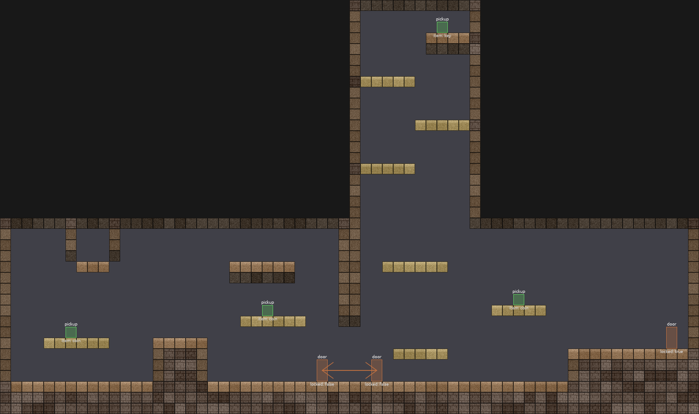
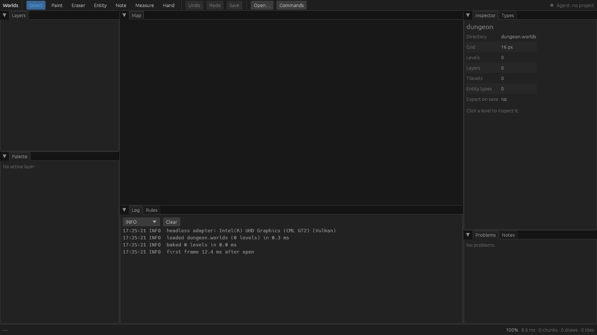
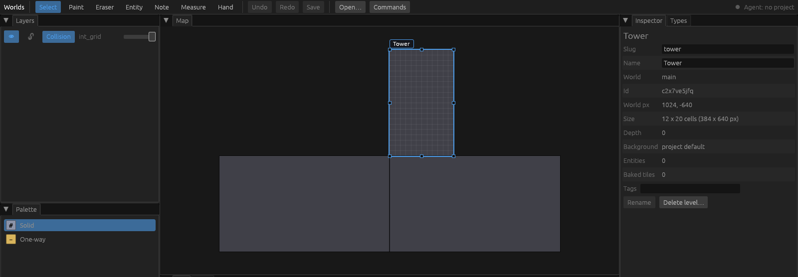
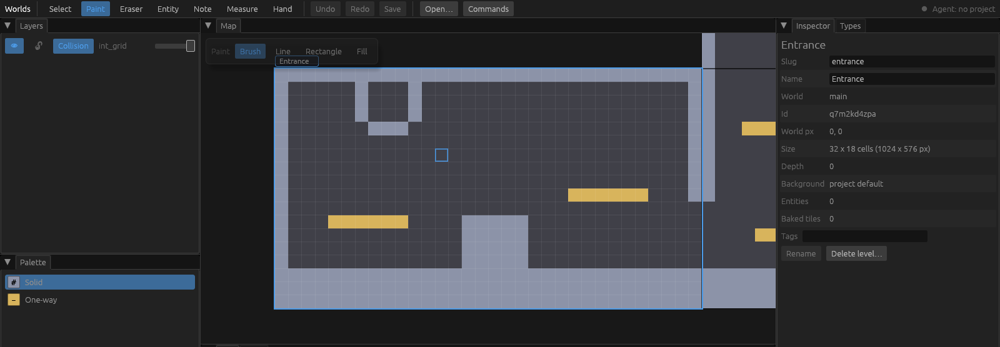
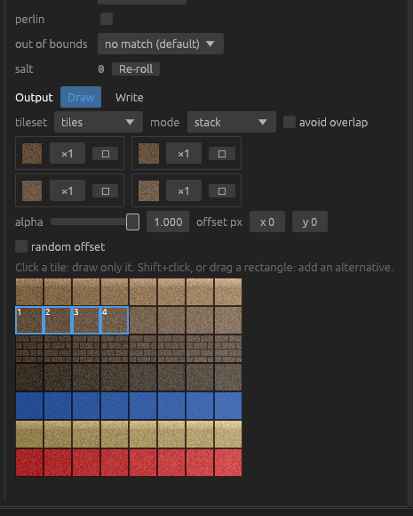
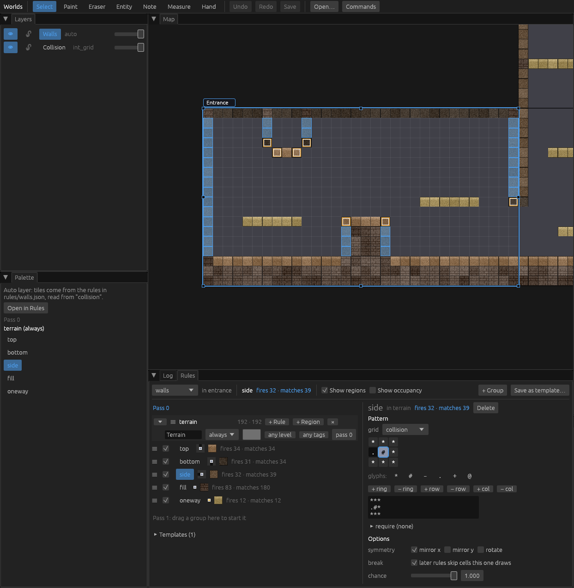
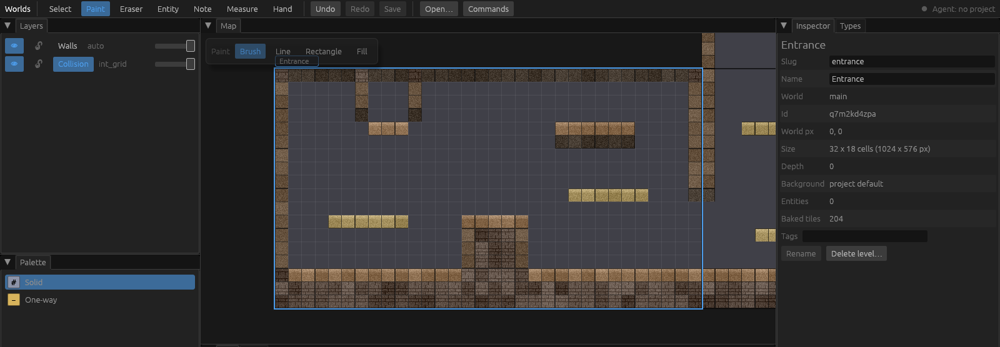
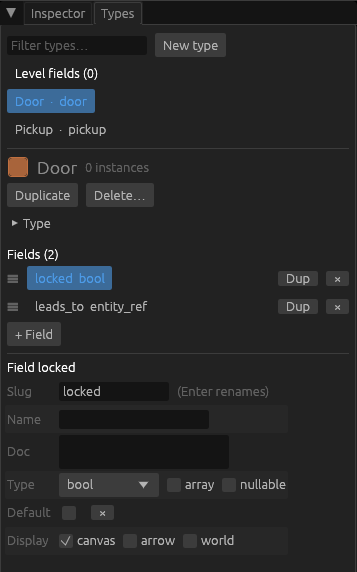
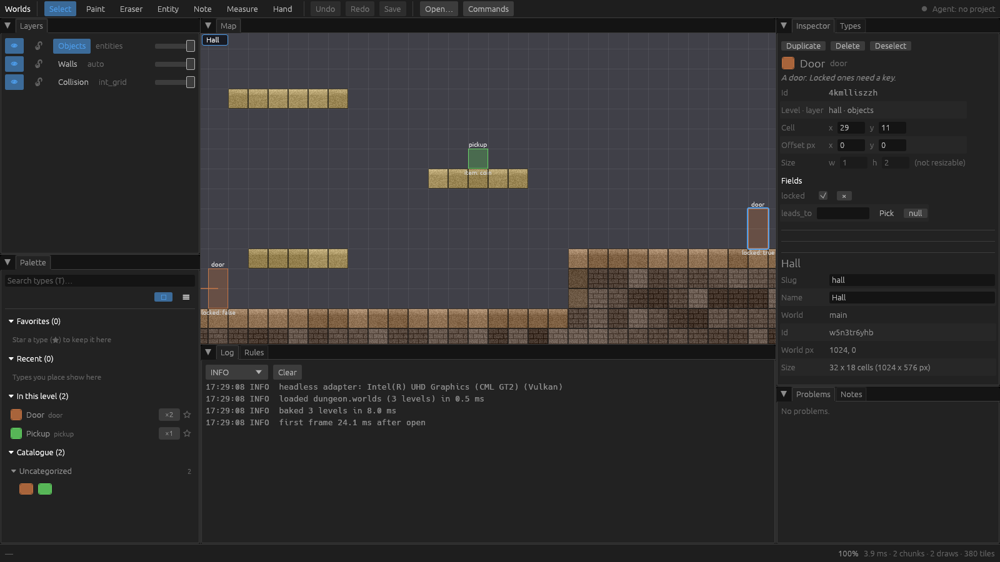

# Tutorial: your first world

This walks you from nothing to a small dungeon: three connected rooms on a
world map, walls that tile themselves as you paint, a few doors and pickups,
and a baked export your game can load. It takes about half an hour.



One idea to keep in mind the whole way: **a Worlds project is just a folder
of small JSON files**. The editor is a nice way to change them, but every
click lands in a file you can open, read, diff and commit. We'll point out
which file each step touches. The full reference for all of them is
[format.md](format.md); you won't need it to follow along.

## 1. Build and create a project

You need Rust 1.95+ and a GPU that wgpu can use (almost any will do).

```sh
cd worlds                                  # your clone of this repo
cargo build --release
export PATH="$PWD/target/release:$PATH"    # worlds and worlds-cli
```

Make the project somewhere outside the repo, say `~/games`:

```sh
cd ~/games
worlds-cli new dungeon.worlds
```

That writes a nearly empty folder:

```
dungeon.worlds/
  project.json        name, grid size, random seed
  layers.json         no layers yet
  tilesets.json       no tilesets yet
  enums.json
  worlds/main/world.json   the one world, "main"
  schema/             JSON Schemas for every file kind (editors can autocomplete with these)
```

Open it:

```sh
worlds dungeon.worlds
```



A quick tour:

- **Toolbar** (top): the tools. Select (V), Paint (P, with Brush, Line,
  Rectangle and Fill modes), Eraser (E), Entity (T), Note (N), Measure (M),
  Hand (H). Then Undo, Redo, Save, and Commands (Ctrl+P), a searchable list
  of everything the editor can do.
- **Layers** (top left): the layers, top of the list drawn on top. Click one
  to make it the one you paint on.
- **Palette** (below Layers): what you paint with. It changes with the active
  layer: values, tiles, or entity types.
- **Map** (middle): every level of the world, laid out where it sits.
- **Log / Rules** (under the map): messages, and the autotile rule editor.
- **Inspector / Types** (right): whatever is selected (or the project
  summary, as here), and the entity type editor.
- **Problems / Notes** (bottom right): live validation. It updates as you
  edit, so you rarely need to go looking for mistakes.

Panes are tabs: drag them around however you like. The layout is remembered
per project in `.worlds/ui.json` (a cache folder you don't commit).

## 2. Collision: what a cell can be

Before drawing anything we need to say what a cell *is*. In a platformer the
most basic fact about a cell is whether you collide with it, so the first
layer is an **int_grid**: a grid where each cell holds one named value or
nothing. We'll have two values, `solid` and `oneway` (a platform you can
jump up through).

There's no layer editor in the UI yet, so this part is a small JSON edit.
That's also the quickest way to see that nothing is hidden.

First, the art we'll use later is 32 x 32 px, so make the grid match. In
`project.json`, change `grid_size` to `32` and name the collision layer (the
export uses it to tell the game which cells block):

```json
{
  "$schema": "schema/project.json",
  "format": 1,
  "name": "dungeon",
  "grid_size": 32,
  "seed": -4887205897904812902,
  "collision_layer": "collision"
}
```

(Keep whatever `seed` you got; it seeds the random tile choices later.)

Then `layers.json`:

```json
{
  "$schema": "schema/layers.json",
  "format": 1,
  "layers": [
    {
      "slug": "collision",
      "name": "Collision",
      "kind": "int_grid",
      "values": [
        { "slug": "solid", "name": "Solid", "color": "#8C93A8", "glyph": "#" },
        { "slug": "oneway", "name": "One-way", "color": "#D8B45C", "glyph": "-" }
      ]
    }
  ]
}
```

Each value gets a **slug** (its name everywhere else), a **color** for the
editor, and a one-character **glyph**. The glyph is how the value is written
in level files and in rule patterns, so pick ones that look like the thing:
`#` for solid, `-` for a thin platform. Pick colors that stand out against
the dark level background; you'll be staring at them.

Save the files. If the editor is open it notices and reloads. Now check:

```sh
worlds-cli validate dungeon.worlds
# ok: 0 levels, no problems
```

`validate` is your friend throughout: it lists every problem with its file
and JSON path, and the editor's Problems pane shows the same list live.

## 3. The world map: levels

A **level** is one room: a rectangle of cells with its own files. Levels sit
on a shared world map in world pixels, so you can see how rooms connect, and
the export tells your game which ones touch.

Make three:

1. Right-click an empty spot on the map and pick **New level here…**.
2. Type a slug, `entrance`, and press Enter. The new level is 32 x 18 cells
   with its top-left corner where you clicked. Its display name starts out
   as the slug; change it in the Inspector (Name, then Rename) if you like.
3. Do the same for `hall` and `tower`.

(The Commands palette, Ctrl+P, also has **New level…**.)

Now arrange them with the **Select** tool (V):

- Drag a level by its **name tab** (the label above the active level's
  top-left corner), or by its body when it isn't the active one. Levels snap
  to the grid.
- Drag an **edge or corner handle** of the active level to resize it.
- **F** frames the active level, **Shift+F** the whole world. The mouse
  wheel zooms; middle-drag, right-drag or Space+drag pans.

Put `hall` to the right of `entrance` so their edges touch, and make `tower`
tall and narrow (12 x 20) on top of the left part of `hall`:



Each level is a folder: `worlds/main/levels/tower/level.json` holds where it
is and how big:

```json
{ "id": "c2x7ve5jfq", "slug": "tower", "name": "Tower",
  "world_px": [1024, -640], "size": [12, 20], "depth": 0 }
```

The `id` is random and permanent; your game can rely on it even if you
rename the level.

> If you skipped step 2: the Select tool can't grab levels in a project with
> no layers at all, so add the collision layer first.

## 4. Painting collision

Click **Collision** in the Layers pane, then press **P** for the Paint tool.
A strip at the top left of the map picks the mode:

| Mode | Key | Does |
| --- | --- | --- |
| Brush | B | paints along the drag |
| Line | L | a straight line, applied on release |
| Rectangle | R | a filled rectangle; hold **Shift** for just the outline |
| Fill | G | flood fills the connected area under the click |

Pick `Solid` or `One-way` in the Palette. **E** is the Eraser, and
**Alt+click** with any painting tool picks up the value under the pointer.
Every stroke is one undo step (Ctrl+Z).

A quick way to rough out a room:

1. Rectangle with Shift held, corner to corner: the outer wall.
2. Plain rectangle over the bottom three rows: a thick floor.
3. The Eraser over a few cells of the right wall: a
   doorway into the next room. Line them up with a gap in the neighbour's
   wall.
4. Lines of `One-way` for platforms, and the Brush for anything else.



Do the same in `hall` (leave a gap in its ceiling under the tower) and in
`tower` (leave its floor open into the hall). The status bar shows the cell
and value under the pointer, handy for lining things up.

Press **Ctrl+S** to save. (Unsaved work is also autosaved every 30 s to
`.worlds/autosave/`, and offered back if the editor ever dies.) Saving
writes only the files you changed. Here that's one per level,
`worlds/main/levels/entrance/collision.json`, and it's literally a picture:

```json
"rows": [
  "################################",
  "#.....#...#....................#",
  ...
  "#.....................------...#",
  "#...............................",
  "#...------....#####.............",
  ...
  "################################"
]
```

You could paint with a text editor if you wanted to. Agents often do.

## 5. Autotiling

Grey blocks are fine for testing but not for shipping. Rather than placing
wall tiles by hand (and redoing them every time a wall moves), you write
**rules**: "a solid cell with nothing above it gets a wall-top tile". The
rules run over the collision grid and produce tiles. Change the grid, and
the tiles follow.

### The tileset

Copy the repo's sample art into the project:

```sh
mkdir dungeon.worlds/art
cp <repo>/tests/fixtures/game/assets/tiles.png dungeon.worlds/art/
```

It's drawn by a script in the repo (`tests/fixtures/game/make.py`), so it's
free to use. The part we need is the top-left corner, 8 columns of shade
variants per row:

| Row | Tiles |
| --- | --- |
| 0 | wall tops (lit top edge) |
| 1 | wall sides |
| 2 | bricks, for the inside of walls |
| 3 | wall bottoms |
| 4 | water |
| 5 | one-way planks |
| 6 | hazards and odds and ends |

Register it in `tilesets.json` (the image path is relative to the project):

```json
{
  "$schema": "schema/tilesets.json",
  "format": 1,
  "tilesets": [
    { "slug": "tiles", "image": "art/tiles.png", "tile_size": [32, 32] }
  ]
}
```

### The auto layer

Tiles from rules go on an **auto** layer. It stores nothing per level; it
just names the grid its rules read. Add it to `layers.json` after the
collision layer (later layers draw on top, so the tiles cover the grey):

```json
    { "slug": "walls", "name": "Walls", "kind": "auto", "source": "collision" }
```

Its rules will live in `rules/walls.json`.

### How a rule thinks

A rule is a little stencil centred on the cell being decided. It's written
as rows of glyphs:

```
*.*
*#*
***
```

`#` means "solid" (the glyph you gave the value), `.` means "empty", and `*`
means "don't care". So this one reads: *I'm solid, the cell above me is
empty, and I don't care about anything else.* That's the top of a wall,
the surface you'd stand on. Where the stencil fits, the rule draws its tile.

Rules are tried **in order**, and a rule with **break** on claims the cell,
so later rules skip it. That gives you an if / else-if chain:

1. `top`: empty above → wall-top tile (break)
2. `bottom`: empty below → wall-bottom tile (break)
3. `side`: empty to the left → side tile, and mirrored for empty to the right (break)
4. `fill`: anything else solid → bricks
5. `oneway`: one-way cells → planks

A one-cell-thick platform is both a top and a bottom; `top` comes first, so
it wins. Edge case worth knowing: a stencil cell that falls *outside* the
level never matches (unless you set the rule's out-of-bounds option), so the
level's top row doesn't count as a "top" even though nothing is above it.
That's what you want for a ceiling.

### The Rules pane

Click **Walls** in the Layers pane; the **Rules** tab comes to the front.

1. Click **+ Group** (top right). A group is a list of rules that run
   together. Give it a name, `Terrain`, in the field under its header.
2. Click **+ Rule** on the group's header. A new rule appears, selected,
   matching any value and drawing tile `[0, 0]`.
3. In the **text box** under the pattern grid, replace `+` with the three
   rows above (Shift+Enter for a new line), then press **Enter**. You can
   also click the grid cells to cycle their glyphs; the box and the grid are
   the same pattern.
4. Under **Options**, tick **break**.
5. Under **Output**, the tileset's atlas is shown. Click tile (0, 0), then
   **Shift+click** (1, 0), (2, 0) and (3, 0). Each is an alternative and one
   is picked at random per cell, so long walls don't look stamped. The
   randomness is seeded: the same project always bakes to the same tiles.



The moment you press Enter the level re-tiles. Now add the other four with
**+ Rule** the same way:

| Rule | Pattern | Options | Tiles |
| --- | --- | --- | --- |
| `bottom` | `***` / `*#*` / `*.*` | break | row 3, cols 0–3 |
| `side` | `***` / `.#*` / `***` | break, symmetry: **mirror x** | row 1, cols 0–3 |
| `fill` | `#` | | row 2, cols 0–7 |
| `oneway` | `-` | | row 5, cols 0–3 |

`mirror x` tries the pattern flipped left-right too, and flips the tile to
match, so one rule handles both walls. Rows can be dragged by their `☰`
handle to reorder them.

The pane names new rules `rule`, `rule_2`, and so on, and can't rename them
yet. The names are only for you (and they feed the dice, so renaming a rule
re-rolls its random choices). If you'd like readable ones, as in the
screenshots, save, change the `slug`s in `rules/walls.json`, and the editor
reloads it.



The pane is also a debugger. Each row says **fires N · matches M** for the
active level, and the selected rule is highlighted on the map: **blue**
where it fired, **orange** where its pattern matched but it didn't fire.
Above, `side` matches the ends of the platforms too, but `top` and `bottom`
came first and claimed them. When a tile looks wrong, select rules until
you find the one that fired there (hovering a cell also lists them in the
status bar).

### Paint, and watch it bake

Back to the Collision layer and the Brush. Paint a new ledge: the tiles
appear under the brush as you drag, tops on top, bottoms underneath, bricks
in between. Only the cells near your stroke are re-baked, so it stays
instant on big levels.



The baked tiles are never saved in the project; only the rules and the grid
are. They're computed again when you open the project and written out when
you bake the export (step 7).

## 6. Entities

Entities are the things in a level that aren't terrain: doors, pickups,
enemies, spawn points. Each has a **type** (with typed **fields**) and
instances placed in levels.

First an entities layer, at the end of `layers.json` so entities draw on
top:

```json
    { "slug": "objects", "name": "Objects", "kind": "entities" }
```

### Define the types

Open the **Types** tab (next to the Inspector) and click **New type**. You
get `new_type`. Unfold **Type** and set:

- **slug** `door` (Enter renames), **name** `Door`
- **size** 1 x 2 cells, **pivot** bottom center (`0.5, 1`), so the cell you
  click is the one the door stands in
- a **color** and, if you like, a **doc** line ("A door. Locked ones need a
  key."); it shows in the Inspector

Then add its fields with **+ Field** (a new field starts as an `int` named
`field`; click it to open its form):

- `locked`: type **bool**, default off, and tick Display **canvas** so the
  value shows next to the door on the map.
- `leads_to`: type **entity_ref**, **nullable**, allowed types `door`,
  **cross level** on, Display **arrow**. It points at another door, in any
  level, and the map draws an arrow to it.



Make a second type, `pickup`, 1 x 1, pivot bottom center, with one field
`item`: type **enum** with inline values `coin`, `key`, `heart`, default
`coin`, shown on canvas.

Each type is one file, `entities/door.json` and `entities/pickup.json`.

### Place them

Press **T** for the Entity tool. The Palette turns into the entity palette:
a search box, favorites, recent, what's in this level, and the full
catalogue. Click **Door**, then click in the level, on the floor next to
the doorway. Put another door on the other side of the doorway in `hall`,
a locked one somewhere else, and a few pickups on platforms. **Alt+click**
an existing entity copies its type and field values into the brush.

Placed entities go in each level's `entities.json`:

```json
{ "id": "4kmlliszzh", "type": "door", "cell": [29, 11], "fields": { "locked": true } }
```

Only fields you've set are stored; the rest take the type's default.

### Edit fields

Switch to **Select** (V) and click a door. The **Inspector** shows its
cell, size and fields:

- Tick **locked**. The map label changes to `locked: true`.
- For `leads_to`, click **Pick**, then click the door on the other side of
  the doorway (zoom out if it's in another level). The id fills in, with
  `door @ hall` under it, and an arrow joins the two. Do the same from the
  other door back.



Select several entities (Ctrl+click, or drag a box in empty space) and the
Inspector edits the fields they share all at once. Delete, Ctrl+D
(duplicate) and the arrow keys (nudge) work on the selection.

Save with Ctrl+S.

## 7. Validate and bake

Close the editor or not, it doesn't matter. Check the project:

```sh
worlds-cli validate dungeon.worlds
# ok: 3 levels, no problems
```

Then **bake**: run every rule and write what the game reads:

```sh
worlds-cli bake dungeon.worlds
# baked 3 level(s), 467 autotiles; 5 files (5 changed) in dungeon.worlds/export
```

```
dungeon.worlds/export/
  world.json            the index: every level's rect, which levels touch, entity type names
  enums.json
  levels/entrance.json  one per level
  levels/hall.json
  levels/tower.json
```

Each level file has the collision grid (same rows as before), the baked
tiles of every tile layer as `[x, y, col, row, flip]`, and every entity with
its position in pixels and *all* its field values, defaults filled in. Your
game never has to know about rules or defaults.

`world.json` does the connective work for you. For each level it lists the
levels it **touches** and its **open edges**, the runs of border cells you
can walk through. For our entrance:

```json
"touching": [{ "level": "hall", "edge": "right", "span": [0, 576] }],
"open_edges": { "left": [], "right": [[10, 15]], "top": [], "bottom": [] }
```

That's the doorway: cells 10 to 14 of the right edge are open, and `hall` is
on the other side. Cells count as open unless their value is a blocking one
(`solid` here; see `blocking_values` in [format.md](format.md#projectjson)).

Baking is deterministic (same project, same bytes) and only rewrites files
that changed, so `export/` diffs cleanly in git. To check an export is
complete and up to date, say in CI:

```sh
worlds-cli check-export dungeon.worlds/export --project dungeon.worlds --fresh
```

Tip: put `"export_on_save": true` in `project.json` and the editor writes
`export/` every time you save.

## Next steps

- **Godot.** The addon in [`godot/addons/worlds/`](../godot/addons/worlds/README.md)
  turns the export into scenes: tile layers, collision shapes from the
  blocking cells, and your own scene per entity type (`door.tscn` for a
  `door`) with its fields set. Keep the project (with `art/`) inside your
  Godot project, copy the addon in, enable it, and run
  **Project > Tools > Import Worlds Export...** on `export/world.json`.
- **More rules.** Groups that run only in some levels, passes, region rules
  ("a torch every 6 cells along every floor"), stamps and the built-in
  47-piece `blob47` template are all in
  [format.md](format.md#rulesltlayergtjson).
- **Agents.** The open editor serves a live API, and `worlds-mcp` lets
  Claude Code or any MCP client paint, place and fix things while you watch,
  each edit one undo step: [mcp.md](mcp.md).
- **Reference.** Every file: [format.md](format.md). Every edit, as a
  command: [commands.md](commands.md). The editor in depth:
  [crates/worlds-editor/README.md](../crates/worlds-editor/README.md).
